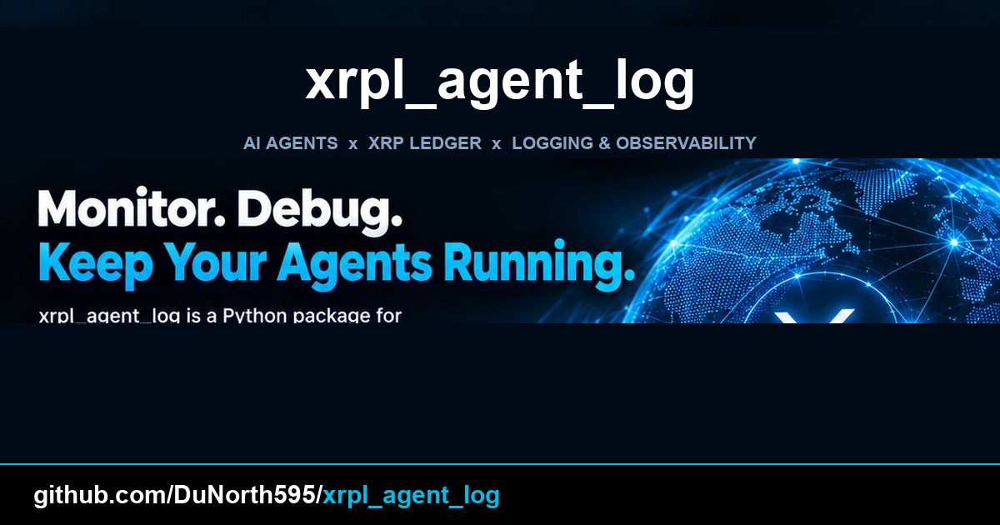

# xrpl_agent_log

A tamper-evident, append-only history log for AI agents on the XRP Ledger.
Hash-chained with SHA-256, mutually signed with ECDSA over secp256k1, and
replayable from public ledger data alone — you make the anchors, this library
verifies them.

[](LICENSE)
[](https://www.python.org/downloads/)
[](https://pypi.org/project/xrpl-py/)
[](https://reuse.software/)
[](https://github.com/DuNorth595/xrpl_agent_log/actions/workflows/ci.yml)
[](https://github.com/DuNorth595/xrpl_agent_log/releases)

<p align="center">
  
</p>

---

## What this is

A small Python library for recording what AI agents did, in a form that cannot
be edited afterwards without detection.

Three layers of tamper-evidence, each independently checkable:

1. **Hash chain** — each entry commits to the one before it. Editing entry 3
   breaks every hash after it.
2. **Mutual signatures** — both parties sign each record. Neither can rewrite
   history unilaterally, and neither can produce a record the other never saw.
3. **Optional on-chain anchor** — you point at an XRPL transaction you already
   submitted. This library verifies the reference against public ledger data.

**Not** a key-management system, wallet, privacy layer, or replacement for a
SIEM. Anchors are public by design. Bring your own keys — use `xrpl-py`'s
`Wallet`.

**Status:** v0.3.0, MIT, testnet-verified.

---

## Quick start

```python
from xrpl.wallet import Wallet
from xrpl_agent_log import Log, SigningPair, SQLiteStorage

# Two parties — each loads its own wallet + DID
wallet_a = Wallet.create()   # In production: load from secure storage
wallet_b = Wallet.create()

# A signing pair is the mutual-attestation identity of the two parties.
# The DID must end in the matching wallet's classic address — the library
# enforces this on every signature and raises ValueError otherwise.
pair = SigningPair(
    wallet_a=wallet_a,
    wallet_b=wallet_b,
    did_a=f"did:xrpl:testnet:{wallet_a.classic_address}",
    did_b=f"did:xrpl:testnet:{wallet_b.classic_address}",
    network="testnet",
)

storage = SQLiteStorage("agent_history.db", log_id="alice<->bob")
log = Log(pair, storage)

# Append — `intent` is required; `params` is any JSON-serializable dict
entry = log.append(
    intent="transfer",
    params={"amount": 100, "currency": "USD"},
)
print(entry.sequence, entry.entry_hash[:16])

# Read back
print(log.count())               # number of entries
print(log.latest().intent)       # most recent Entry (or None on an empty log)
for e in log.replay():           # walk the chain oldest -> newest
    print(e.sequence, e.intent)

# Verify — every helper returns a VerificationResult, not a bare bool
from xrpl_agent_log import verify_chain, verify_signatures, verify_on_chain_anchor

result = verify_chain(log)
assert result.ok, result.errors

result = verify_signatures(log, wallet_a, wallet_b)
assert result.ok, result.errors
```

Every verification helper returns `VerificationResult(ok: bool, errors: list[str])`
so you get the failure reason, not just `False`.

---

## On-chain anchoring

**This library does not submit transactions.** There is no code path in `src/`
that constructs, signs, or sends one.

`on_chain_tx_hash` is an opaque string *you* supply. The library stores it,
folds it into the entry hash so it is tamper-evident like any other field, and
can optionally check that it resolves to a real transaction.

| | |
|---|---|
| Stores your anchor hash | yes |
| Includes it in the entry hash | yes |
| Verifies it resolves to a real tx | yes — requires an `xrpl_client` |
| Submits a Payment transaction | no |
| Chooses an amount or destination | no |
| Decides whether to anchor | no |
| Keeps your keys | no — bring your own `xrpl-py` `Wallet` |

### Typical workflow

```python
from xrpl.clients import WebsocketClient
from xrpl.transaction import Payment, TxResponse

# 1. You decide what, if anything, to put on the ledger.
client = WebsocketClient("wss://xrplcluster.com")
tx: TxResponse = Payment(
    account=wallet,
    destination=anchor_sink,
    amount="1",                      # 1 drop — a minimum-fee payment
    last_ledger_sequence=75,
).submit_and_wait(client)

# 2. You record what you did.
entry = log.append(
    intent="settle",
    params={"invoice": "inv-42"},
    on_chain_tx_hash=tx.result["hash"],
)

# 3. Anyone can later check that reference against public data.
from xrpl_agent_log import verify_on_chain_anchor
result = verify_on_chain_anchor(log, client)
assert result.ok, result.errors
```

### What anchoring does and does not buy you

Anchoring publishes a **timestamped reference**. It proves a transaction existed
at a point in ledger history. It does **not** publish entry contents — the
`params` payload stays wherever your storage is. Entries carrying an anchor are
public by design.

> `verify_on_chain_anchor(log, client=None)` returns `ok=True` when no client
> is passed. A skipped check is not a passing check. If you need anchors
> verified, pass a client.

---

## Comparing approaches

Other ways to get tamper-evident agent execution records, and how this library
relates to them. Not a scoreboard — XAIP is a serious project with a different
design center.

> **Data as of 2026-10-27.** Star counts, forks, licenses, and last-push dates
> below were read from the GitHub API on that date and will drift. The
> *descriptions* — what each project actually does — are the durable part.

| Project | What it does | Language | License | Notes | Last push |
|---|---|---|---|---|---|
| **`xrpl_agent_log`** (this) | Two-party mutual attestation: hash-chained entries, both parties sign each record, optional XRPL anchor | Python | MIT | Peer-to-peer — a log is *between* two agents. Verification needs only public keys and the chain | active |
| [`xaip-protocol`](https://github.com/xkumakichi/xaip-protocol) | Provider-neutral execution evidence — co-signed receipts (agent and caller both sign) | TypeScript | MIT | Closest in spirit and in the co-signing model. Chain-agnostic; SDK, aggregator, MCP servers, conformance vectors. Supports `did:xrpl` as one optional identity | 2026-07-30 |
| [`novatechflow/lucendex`](https://github.com/novatechflow/lucendex) | Deterministic DEX infrastructure for XRPL with "compliance-grade audit trails" | Go | MIT | **Archived.** Audit trails are one feature of a broader DEX product | 2026-10-21 |
| XRPL `SourceTag` + `Memo` | 32-bit submitter-set tag plus free-form memo | — | XRPL protocol | Ripple's guidance says to audit an agent's spend by **filtering by the agent's account, not by tag** — nothing binds a tag to a signing agent | live |
| Ripple Custody (Vault) | Merkle tree over trusted entities, notary-signed root per state change, anti-rewind file, per-entity signatures | — | proprietary | Not an XRPL-native library — a commercial platform. Its architecture is the reference design for tamper-evident custody | live |
| Conventional off-chain logging (Postgres, SIEM) | Centralized application logs with retention and access controls | — | varies | The incumbent for compliance work — central trust anchor, records only as durable as the host | n/a |

### What the table actually says

- **XAIP is the project to look at first.** It co-signs execution receipts the
  same way, and it is more developed — SDK, aggregator, MCP servers, and
  conformance CI. Its center of gravity is *provider-neutral* execution
  evidence; this library's is *XRPL-native* mutual attestation with optional
  on-chain anchoring.
- **The built-in XRPL mechanism is not an audit trail.** Ripple's own
  agent-payment guidance says to audit an agent's spend by filtering by the
  agent's **account**, not by tag. `SourceTag` is a submitter-set integer, so
  nothing binds a tag to a signing agent — and nothing binds an identity to the
  transactions it signs.
- **Centralized logging remains the incumbent for compliance.** It is what
  auditors expect and what operations teams can actually query. The trade-off
  is a trust anchor: the records are only as good as the host and the operator
  holding them.
- **What this library offers instead** is a record whose integrity can be
  re-derived by anyone from public data, with no trust in the logging host and
  no operator who can quietly alter it.

---

## Relationship to `xrpl_agent_id`

Two libraries, layered:

| | [`xrpl_agent_id`](https://github.com/DuNorth595/xrpl_agent_id) | `xrpl_agent_log` |
|---|---|---|
| Answers | Who is this agent? | What has it done? |
| Produces | identity, credentials, authorization | signed, chained history |
| Needed by the other | no | optional |

`xrpl_agent_id` gives an agent an identity and an authorization model.
`xrpl_agent_log` records agreements **between** two such agents in a form that
cannot be edited afterwards without detection.

The `agent_a_did` / `agent_b_did` fields on an entry reference agent
identities. They are carried as strings; Agent Log does not resolve them and
does not require them to come from Agent ID.

Each library is usable alone. Install `xrpl_agent_id` alongside this one if you
want identity as well as history.

---

## Install

Neither `xrpl_agent_log` nor `xrpl_agent_id` is published to PyPI. Install from
source:

```bash
# Install xrpl_agent_log — pulls xrpl_agent_id from GitHub automatically
pip install "xrpl_agent_log @ git+https://github.com/DuNorth595/xrpl_agent_log.git@v0.3.0"
```

For development (test + pre-commit):

```bash
git clone https://github.com/DuNorth595/xrpl_agent_log.git
cd xrpl_agent_log
pip install -e ".[dev]"
pre-commit install   # enables the local seed-scanner hook
```

---

## Highlights

- **Three layers of tamper-evidence** — hash chain, mutual signatures, optional
  on-chain anchor. The library *records* an anchor tx hash you supply and
  verifies it against the ledger; it does **not** submit the anchor transaction
  itself.
- **No infrastructure** — pure Python + SQLite + XRPL JSON-RPC.
- **Auditor-friendly** — verify with just public keys, the chain, and JSON-RPC.
- **Live-testable on XRPL Testnet** — 43 offline tests pass by default; the
  live testnet test is gated behind `RUN_LIVE=1` and self-skips, so a normal
  run reports `43 passed, 1 skipped` *(verified against v0.3.0 on
  2026-10-27)*.
- **Honest about limits** — see [SECURITY.md](SECURITY.md) and
  [`docs/03_known_issues.md`](docs/03_known_issues.md) for known issues.

---

## Documentation

| Doc | Purpose |
|---|---|
| [`docs/ARCHITECTURE.md`](docs/ARCHITECTURE.md) | How the hash chain, signing, and anchoring actually work |
| [`docs/00_executive_summary.md`](docs/00_executive_summary.md) | One-page pitch |
| [`docs/01_usage.md`](docs/01_usage.md) | API reference + examples |
| [`docs/02_testing_log.md`](docs/02_testing_log.md) | Test layout and what each layer proves |
| [`docs/03_known_issues.md`](docs/03_known_issues.md) | Honest disclosures from live testing |
| [`SECURITY.md`](SECURITY.md) | Security policy, threat model, seed rules |

---

## Related projects

- [`xrpl_agent_id`](https://github.com/DuNorth595/xrpl_agent_id) — companion library: agent identity and authorization on XRPL
- [`xaip-protocol`](https://github.com/xkumakichi/xaip-protocol) — provider-neutral execution evidence for agent tool calls
- [`xrpl-py`](https://github.com/XRPLF/xrpl-py) — the Python client this wraps

---

## License

MIT — see [LICENSE](LICENSE).

```
SPDX-FileCopyrightText: 2026 Justin Douglas
SPDX-License-Identifier: MIT
```

**Author:** Justin Douglas — design, implementation, and stewardship.

**Built with Sam Intelligence** — an AI coding assistant (Hermes Agent, Nous
Research) that contributed to implementation, documentation, and architecture
under direct human supervision. All design decisions, specification
interpretations, and final commits were reviewed and approved by Justin
Douglas.

**Built on the shoulders of:** [Wietse Wind](https://github.com/WietseWind) and
`xrpl-py`; the [XRPL Foundation](https://xrpl.org/) for the ledger primitives;
and [Ripple Custody](https://ripple.com/) for the Merkle-tree-plus-anti-rewind
architecture that this design follows.

**How to cite:**

```bibtex
@software{xrpl_agent_log_2026,
  author = {Douglas, Justin},
  title = {xrpl_agent_log: Tamper-evident agent history on the XRP Ledger},
  year = {2026},
  url = {https://github.com/DuNorth595/xrpl_agent_log}
}
```
